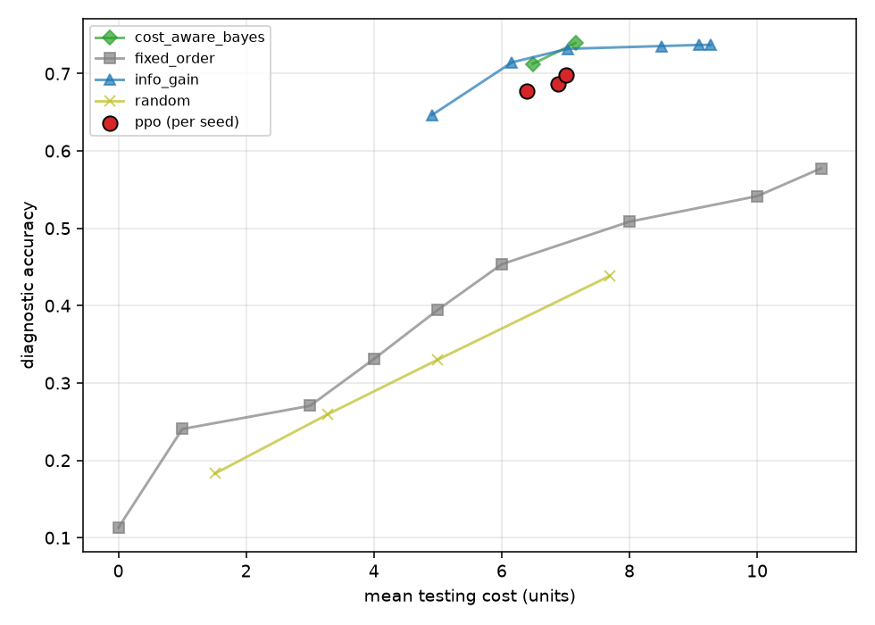
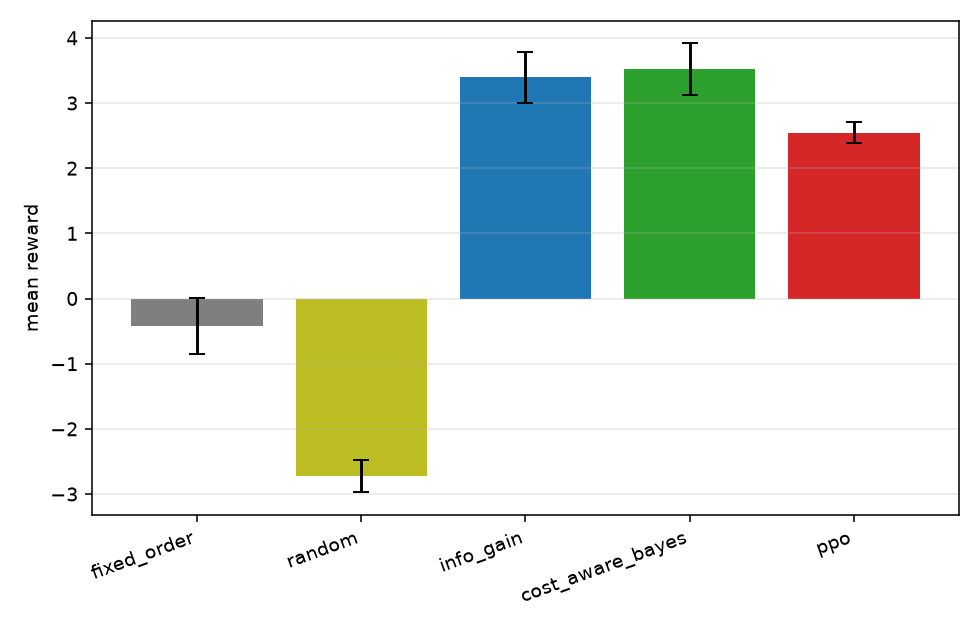
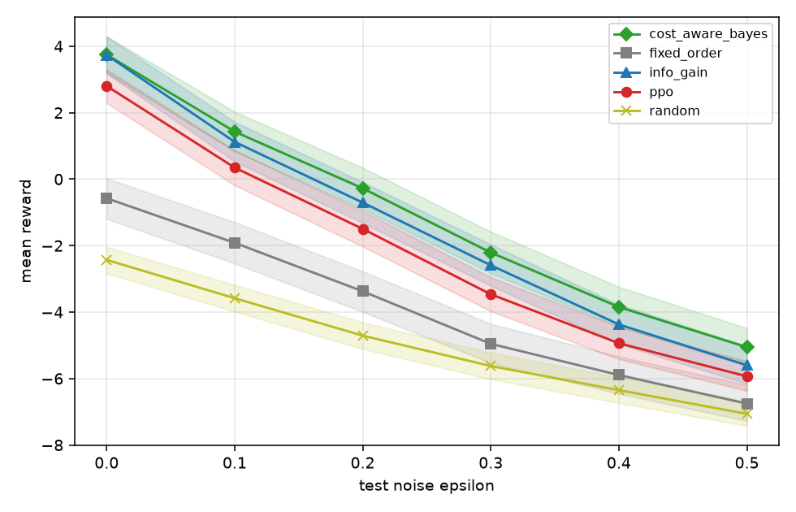
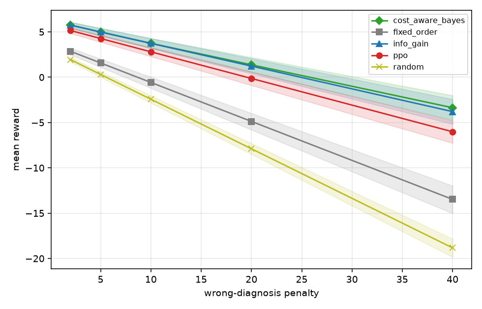
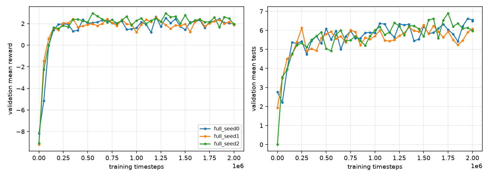
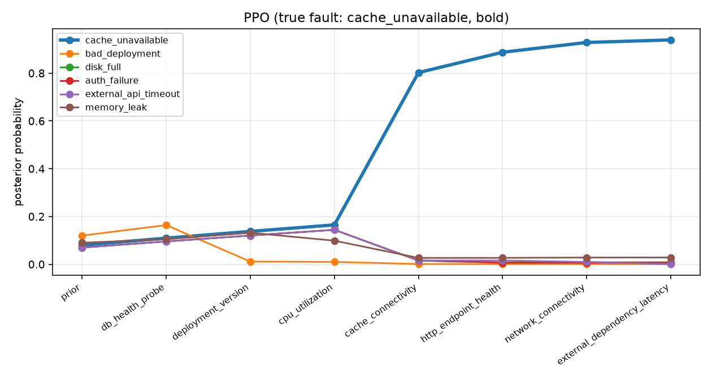

# Results

Everything below is generated from recorded evaluation runs; the raw files are in
[`docs/figures/`](figures/) (`standard_results.json`, `small_results.json`,
`ablation_no_posterior_results.json`, `standard_stopping.json`). **These are simulator results.** The
scenario's probabilities are hand-authored, so nothing here shows how the methods would perform on
real systems. See [limitations.md](limitations.md).

## Setup

* Scenario `standard`: 12 root causes, 13 tests, step cap 9. Reward: +10 correct, −10 wrong, −10
  timeout, test penalty `0.5·cost/max_cost + 0.5·duration/max_duration`.
* PPO: MaskablePPO, 2,000,000 timesteps, 3 training seeds (0, 1, 2), checkpoint chosen by validation
  reward, hyper-parameters tuned lightly on the validation set (one seed). See
  [`configs/full.yaml`](../configs/full.yaml).
* Test set: **2,000 incidents** from a seed never used in training or model
  selection. Baseline parameters (fixed-order `k`, random stop probability, information-gain
  threshold) were tuned on 1,000 separate validation incidents: `{"fixed_order": 8, "random": 0.1, "info_gain": 0.8, "cost_aware_bayes": 2}`.
* All policies are scored on identical incidents with identical potential test outcomes.
* Run on a laptop CPU; each PPO seed took about 45 minutes (three in parallel).

## Main comparison (standard scenario)

| policy | accuracy | tests | cost | duration (s) | no-diagnosis | mean reward (95% CI) |
|---|---|---|---|---|---|---|
| fixed_order | 0.578 | 8.00 | 11.00 | 36.0 | 0.000 | -0.42 [-0.85, 0.01] |
| random | 0.438 | 5.08 | 7.69 | 31.6 | 0.000 | -2.72 [-2.98, -2.48] |
| info_gain | 0.732 | 6.16 | 7.04 | 21.9 | 0.000 | 3.40 [3.00, 3.78] |
| cost_aware_bayes | 0.740 | 6.10 | 7.16 | 22.5 | 0.000 | 3.52 [3.13, 3.91] |
| **ppo** (mean ± std, 3 seeds) | 0.687 ± 0.011 | 5.58 ± 0.26 | 6.76 ± 0.33 | 21.4 ± 1.7 | 0.007 ± 0.010 | 2.54 ± 0.16 |

Per-seed PPO mean reward: full_seed0 2.48, full_seed1 2.73, full_seed2 2.43.

Paired bootstrap over incidents (seed-averaged PPO minus each baseline):

| PPO minus … | difference in mean reward | 95% CI | excludes 0 |
|---|---|---|---|
| fixed_order | +2.969 | [+2.531, +3.414] | yes |
| random | +5.266 | [+4.962, +5.563] | yes |
| info_gain | -0.851 | [-1.098, -0.599] | yes |
| cost_aware_bayes | -0.976 | [-1.239, -0.723] | yes |

The cost-aware Bayesian policy and information gain sit on the efficient frontier; PPO is close to it
but below; the runbook and random policies are far lower at the same cost.

## Research questions

**RQ1: Does RL outperform fixed-order and random troubleshooting?** Yes, clearly, in this simulator.
On the standard scenario PPO earns +2.97 reward per incident over the
(validation-tuned, 8-test) runbook and +5.27 over random, with intervals far
from zero. It does so with fewer tests and lower cost than the runbook.

**RQ2: Does RL outperform information-gain-based selection?** **No.** On the standard scenario PPO is
worse than information gain (-0.85, CI excludes 0) and worse than the cost-aware
Bayesian policy (-0.98, CI excludes 0), roughly 25–30% less reward. On the
small 4-fault scenario the picture is different (see below): PPO is statistically indistinguishable
from information gain and within about 4% of the exact optimum. So the learned policy is competitive
when the problem is small and falls behind as it scales to 12 faults and 13 tests, with this amount
of training and tuning. The Bayesian baselines receive the exact generative model for free; PPO has to
learn it from experience.

**RQ3: Can RL learn when to stop investigating?** Partly. PPO's number of tests varies across
incidents (it stops early when evidence is conclusive and keeps testing when it is not), unlike the
fixed runbook, and every policy is far more accurate when its posterior is confident:

| policy | tests (mean ± std) | tests p10 – p90 | posterior confidence at declaration | accuracy: low / high confidence half |
|---|---|---|---|---|
| fixed_order | 8.00 ± 0.00 | 8 – 8 | 0.587 | 0.37 / 0.79 |
| info_gain | 6.16 ± 1.95 | 3 – 8 | 0.725 | 0.58 / 0.88 |
| cost_aware_bayes | 6.10 ± 1.77 | 3 – 8 | 0.739 | 0.60 / 0.88 |
| full_seed0 | 5.77 ± 1.86 | 2 – 8 | 0.708 | 0.48 / 0.86 |
| full_seed1 | 5.70 ± 1.80 | 3 – 8 | 0.694 | 0.55 / 0.84 |
| full_seed2 | 5.28 ± 2.22 | 1 – 8 | 0.685 | 0.50 / 0.83 |

PPO tends to stop slightly earlier, at lower confidence (0.69–0.71 versus 0.73–0.74), which is part
of its accuracy deficit. It also occasionally fails to declare before the step cap (no-diagnosis rate
0.7% ± 1.0%); the Bayesian baselines never do because they are
programmed to declare on the last step.

**RQ4: How does performance change as tests become noisier or more expensive?** All policies degrade
as tests get noisier (ε blends each outcome distribution with a uniform one) or as testing gets more
expensive (`lambda_cost` and `lambda_time` scaled), and the ordering never changes: Bayesian
policies > PPO > runbook > random. PPO is **not retrained** for these conditions. Mean reward per
incident on 1,000 test incidents, with the gap between the cost-aware policy and PPO:

*Test noise ε*

| value | fixed_order | random | info_gain | cost_aware_bayes | ppo | gap: cost-aware − PPO |
|---|---|---|---|---|---|---|
| 0 | -0.57 | -2.43 | 3.74 | 3.75 | 2.80 | 0.94 |
| 0.1 | -1.91 | -3.58 | 1.12 | 1.43 | 0.35 | 1.08 |
| 0.2 | -3.38 | -4.71 | -0.71 | -0.28 | -1.50 | 1.22 |
| 0.3 | -4.95 | -5.62 | -2.59 | -2.21 | -3.47 | 1.26 |
| 0.4 | -5.89 | -6.35 | -4.37 | -3.85 | -4.94 | 1.09 |
| 0.5 | -6.75 | -7.06 | -5.60 | -5.06 | -5.93 | 0.88 |

*Test cost multiplier*

| value | fixed_order | random | info_gain | cost_aware_bayes | ppo | gap: cost-aware − PPO |
|---|---|---|---|---|---|---|
| 0.25 | 0.91 | -1.31 | 4.67 | 4.89 | 3.70 | 1.19 |
| 0.5 | 0.41 | -1.68 | 4.36 | 4.55 | 3.40 | 1.14 |
| 1 | -0.57 | -2.43 | 3.74 | 3.75 | 2.80 | 0.94 |
| 2 | -2.55 | -3.93 | 2.50 | 2.59 | 1.61 | 0.98 |
| 4 | -6.50 | -6.92 | 0.01 | 0.55 | -0.78 | 1.33 |

*Wrong-diagnosis penalty* (PPO trained at 10)

| value | fixed_order | random | info_gain | cost_aware_bayes | ppo | gap: cost-aware − PPO |
|---|---|---|---|---|---|---|
| 2 | 2.87 | 1.94 | 5.75 | 5.76 | 5.16 | 0.60 |
| 5 | 1.57 | 0.30 | 4.99 | 4.99 | 4.27 | 0.72 |
| 10 | -0.57 | -2.43 | 3.74 | 3.75 | 2.80 | 0.94 |
| 20 | -4.88 | -7.90 | 1.23 | 1.37 | -0.14 | 1.51 |
| 40 | -13.47 | -18.83 | -3.79 | -3.36 | -6.02 | 2.65 |

The gap to the cost-aware policy stays roughly constant under noise (0.88–1.26) and
cost changes (0.94–1.33), but **widens as the wrong-diagnosis penalty rises**
(0.60 at penalty 2 up to 2.65 at penalty 40): the agent learned the
accuracy/cost trade-off of its training reward and cannot adapt when the penalty changes, while the
Bayesian policy re-optimises for whatever reward it is given. Retraining PPO per condition was not
done, so these numbers show transfer of a nominal policy, not the best RL could achieve.

**RQ5: Does the learned policy generalise to changed fault distributions?** Reasonably, but less
well than the baselines adapt. Five random alternative priors (Dirichlet), PPO not retrained:

| shift | fixed_order | random | info_gain | cost_aware_bayes | ppo | gap to best Bayesian policy (min – max) | PPO beats runbook and random |
|---|---|---|---|---|---|---|---|
| informed (beliefs know the new prior) | 2.31 | -0.08 | 5.15 | 5.48 | 3.68 | 1.28 – 2.46 | 5/5 |
| misspecified (incidents from the new prior, beliefs keep the old one) | 0.81 | -2.67 | 3.62 | 4.09 | 2.96 | 0.76 – 1.67 | 5/5 |

PPO keeps beating the runbook and random policies under every shift, but its gap to the Bayesian
policies is generally larger than at the nominal prior when beliefs are informed (they use the new
prior exactly; PPO's learned decision rule was fit to the old one). A fixed-size network also cannot
transfer to a different number of faults or tests without retraining.

## Gap to the exact optimum (small scenario)

The exact dynamic-programming solver is only tractable on the small scenario (4 faults, 5 tests, 1,024
evidence states). PPO was trained there for 500,000 steps with 3 seeds
([`configs/small_full.yaml`](../configs/small_full.yaml)) and evaluated on 3,000 test incidents:

| policy | accuracy | tests | cost | duration (s) | no-diagnosis | mean reward (95% CI) |
|---|---|---|---|---|---|---|
| fixed_order | 0.882 | 4.00 | 4.00 | 15.0 | 0.000 | 6.60 [6.37, 6.83] |
| random | 0.775 | 3.67 | 5.13 | 25.6 | 0.000 | 4.00 [3.79, 4.21] |
| info_gain | 0.871 | 2.46 | 2.68 | 11.6 | 0.000 | 6.68 [6.44, 6.93] |
| cost_aware_bayes | 0.889 | 2.82 | 2.92 | 11.8 | 0.000 | 6.99 [6.76, 7.22] |
| **ppo** (mean ± std, 3 seeds) | 0.873 ± 0.007 | 2.79 ± 0.17 | 2.82 ± 0.18 | 10.3 ± 1.3 | 0.000 ± 0.000 | 6.74 ± 0.08 |

* Analytic optimal value (dynamic programming): **6.952**. Simulated return of the
  exact policy on the test incidents: 7.011 (sampling noise explains the
  small difference; this also cross-validates the environment's reward accounting against the solver).
* PPO (6.74 ± 0.08) reaches about 96% of the optimal return on
  identical incidents.

| PPO minus … | difference in mean reward | 95% CI | excludes 0 |
|---|---|---|---|
| fixed_order | +0.139 | [+0.046, +0.236] | yes |
| random | +2.737 | [+2.555, +2.918] | yes |
| info_gain | +0.054 | [-0.127, +0.240] | no |
| cost_aware_bayes | -0.255 | [-0.379, -0.130] | yes |

## Ablation: is the posterior in the observation needed?

PPO trained with `include_posterior: false` (raw outcomes only), same budget and seeds, same test set
([`configs/ablation_no_posterior.yaml`](../configs/ablation_no_posterior.yaml)):

| observation | accuracy | tests | mean reward |
|---|---|---|---|
| with Bayesian posterior | 0.687 ± 0.011 | 5.58 ± 0.26 | 2.54 ± 0.16 |
| without posterior | 0.689 ± 0.015 | 5.74 ± 0.40 | 2.43 ± 0.24 |

The difference is within seed-to-seed variation, so with three seeds there is **no evidence that
supplying the posterior helps PPO** at this training budget: the network can learn a usable belief
from raw outcomes. (Only three seeds, so small effects cannot be excluded.)

## Training behaviour

Validation reward rises quickly and then plateaus at about 2–2.5 with noticeable evaluation noise
(500 validation incidents). With the Stable-Baselines3 default entropy coefficient (0.01) training
collapsed to "run one test, then declare"; raising it to 0.05 and the learning rate to 5e-4 fixed that
(see [training.md](training.md)). More tuning, longer training or a different algorithm may close part
of the gap to the Bayesian baselines; this was not explored.

## What would be needed before any live use

1. Fault/test probabilities estimated from real incidents, with selection bias addressed,
   rather than hand-authored.
2. Evaluation on real held-out incidents, with correlated tests modelled properly.
3. Human-approved, read-only diagnostic adapters, audited and rate-limited.
4. Retraining or robust design for changed costs, penalties, priors and test catalogues.
